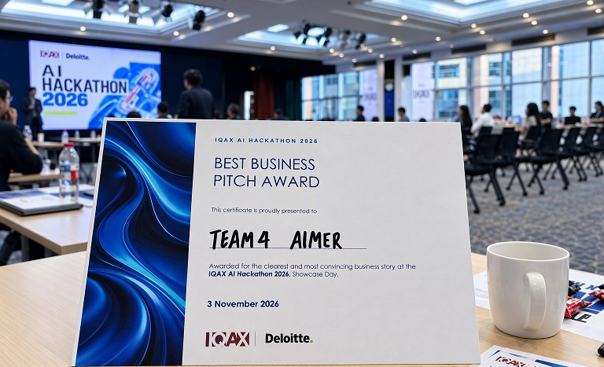

    <a href="/" class="back-home-btn">← Back to Home</a>

Winning the Best Business Pitch Award at the IQAX AI Hackathon 2026 was both an exciting achievement and a powerful reminder of what can happen when talented people are given the space to think differently. I want to express my sincere gratitude to IQAX and Deloitte for organizing such an inspiring, forward-looking event. Beyond the competition itself, the hackathon created a rare opportunity for colleagues across our Hong Kong and China offices to collaborate side by side. Stepping away from our day-to-day operational routines allowed us to challenge assumptions, explore fresh perspectives and reimagine how artificial intelligence can unlock true enterprise value.

What made this journey so compelling was that it was never just about building another tech solution alone. Historically, internal operations and marketing functions have been treated as traditional cost centers focused on support, but our team asked a fundamental question 'What if these same functions could be transformed into agile growth engines that actively drive value and business outcomes?' To answer this, we developed 'AIMer', a name representing the synergy between AI, precise AIM and Marketers. We focused on market signals move faster than ever that leads to skyrocketing content demands, and teams often work across fragmented tools with disconnected feedback loops. As a result, valuable insights are frequently lost before they can be converted into business impact.

Our vision was to build a framework that connects real-time market intelligence, AI-assisted generation, and human expertise into a single, unified workflow. Rather than replacing people, AIMer amplifies human capability, enabling teams to respond faster to market shifts, test ideas with greater agility, and reach the right audience with precision. By keeping human review at the core, AIMer balances speed with accuracy, allowing organizations to scale without sacrificing quality or brand reputation. What resonated most with the judges was the strategic business impact behind the technology. We demonstrated how AI can elevate operational capabilities into strategic growth assets. Instead of viewing content creation, knowledge management, and workflow coordination as overhead, organizations can leverage AI to convert market signals into actionable insights, modular assets, and measurable results. In essence, the exact functions traditionally viewed as costs become drivers of top-line value.

Winning this award reflects the creativity, dedication, and diverse perspectives of the entire Team AIMer. Turning an ambitious concept into a winning pitch within a tight timeframe showed that real innovation happens when technology, business strategy, and cross-border teamwork align. As AI continues to reshape global industries, the greatest opportunities lie in our ability to reimagine how work gets done and how value is created. The IQAX AI Hackathon challenged us to do exactly that, and I look forward to carrying this momentum into the future of logistics technology and digital transformation.

#IQAX #Deloitte #AIHackathon #TeamAIMer #ArtificialIntelligence #Innovation #DigitalTransformation #SupplyChainTech #LogisticsTech #BusinessTransformation

    <a href="/" class="back-home-btn">← Back to Home</a>

