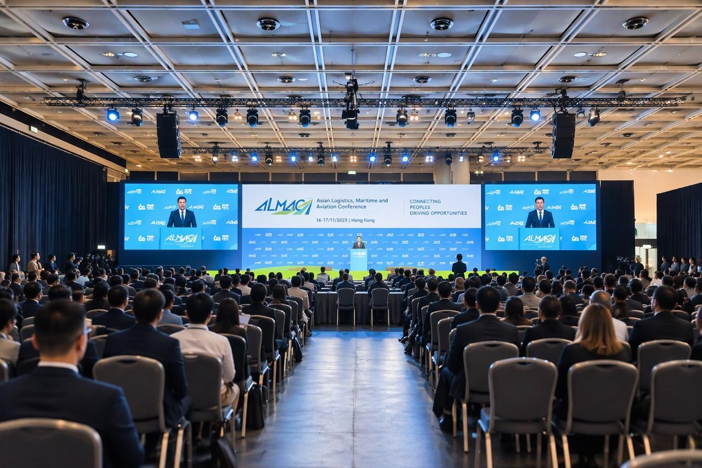

<a href="/" class="back-home-btn">← Back to Home</a>

# Maritime and Trade Finance Are Shaping Hong Kong’s Next Chapter Beyond the Container

Walking through the conference halls of Hong Kong Maritime Week 2026, I realized that the future of the city’s maritime dominance is measured not only in container throughput, but also in the capital, contracts, and digital infrastructure powering global supply chains. Under flagship themes like "Capital Meets Cargo: Financing the Future of Global Trade," industry leaders, shipowners, and financiers are converging on a strategic evolution. Rather than competing solely on physical port volume, Hong Kong is doubling down on its unique DNA as both a premier international financial center and a historic maritime hub to capture the high-value-added segments of the global shipping economy.

At the heart of this shift is the deepening convergence of maritime operations and specialized trade finance. As global shipping navigates geopolitical realignments and an urgent green energy transition, the capital required for fleet decarbonization, alternative marine fuels, and resilient supply chains has grown exponentially. Hong Kong is positioning itself as the indispensable bridge where green ambition becomes bankable reality. Supported by targeted tax concessions for ship leasing and marine insurance, alongside its status as the world’s largest offshore RMB hub, the city offers shipowners and commodity traders an unmatched ecosystem for cross-border financing, risk management, and RMB-denominated trade settlement.

Equally transformative is the digital foundation underpinning this financial pivot. Trade finance has historically been slowed by paper-heavy processes, fragmented data, and trust gaps between cargo owners, carriers, and banks. Today, initiatives like Hong Kong’s digital Port Community System and the broader adoption of electronic trade documentation are unlocking real-time visibility across physical cargo movements. When verified ocean schedules, smart port data, and digital bills of lading flow seamlessly to financial institutions, banks can underwrite working capital faster, reduce fraud risk, and extend liquidity deeper into supply chains.

Ultimately, the conversations at this year’s Maritime Week reflect a city reinventing its role as a global "super connector". By marrying world-class common law arbitration, green shipping corridors, and data-driven trade finance, Hong Kong is proving that modern maritime leadership belongs to the hubs that can finance, insure, and digitize global commerce from end to end.

    <a href="/" class="back-home-btn">← Back to Home</a>

